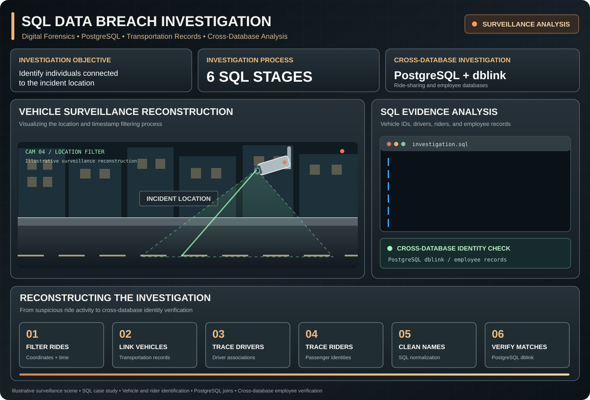

# 🔎 SQL Data Breach Investigation
### PostgreSQL | Digital Forensics | Data Integration | SQL Analysis

Investigated a corporate data breach by connecting ride-sharing activity, vehicle records, and employee databases to identify individuals associated with a security incident.

**Core Skills:** SQL Joins • PostgreSQL • Data Cleaning • Entity Resolution • Cross-Database Queries • Investigative Analytics

---

## 🎥 Investigation in Action



*Animated project visualization illustrating vehicle surveillance, SQL query execution, and cross-database identity verification. Surveillance footage is illustrative, not actual evidence.*

---

## 📌 Project Overview

A suspected data breach at **Keiko Corp** required investigators to determine who was near the company's location during the incident.

The challenge was that the relevant information was distributed across separate databases:

- **Ride-sharing records:** Trip activity, timestamps, and geographic coordinates.
- **Vehicle and driver records:** Vehicle IDs and associated drivers.
- **Passenger records:** Individuals connected to the rides.
- **Employee database:** Internal employee identities maintained separately from the transportation data.

Using PostgreSQL, I developed a six-stage SQL investigation to connect these datasets, narrow the pool of individuals, and identify overlapping records.

## 🎯 Investigation Objective

**Identify individuals connected to Keiko Corp during the security incident by tracing transportation activity and cross-referencing identities against internal employee records.**

The investigation focused on three questions:

1. Which rides occurred near the company during the incident?
2. Which vehicles, drivers, and passengers were associated with those rides?
3. Did any of those individuals appear in the company's employee database?

---

## 🧩 Investigation Workflow

| Stage | Investigation | SQL Techniques |
|---|---|---|
| **01 — Filter Rides** | Isolate transportation activity near the incident location and time | `WHERE`, timestamps, geographic coordinates |
| **02 — Link Vehicles** | Connect relevant trips to vehicle identifiers | Relational `JOIN` |
| **03 — Trace Drivers** | Identify drivers associated with the vehicles | Multi-table joins |
| **04 — Trace Riders** | Identify passengers connected to the trips | Relational joins, `DISTINCT` |
| **05 — Clean Names** | Standardize rider names for comparison | `split_part`, string manipulation |
| **06 — Verify Identities** | Compare rider identities against the employee database | `dblink`, cross-database joins |

### 01. Filter Transportation Activity

Used timestamp and geographic-coordinate conditions to isolate ride-sharing activity near Keiko Corp during the incident window.

**Purpose:** Reduce the search space from broader transportation activity to potentially relevant rides.

### 02. Connect Vehicle Records

Joined the filtered ride data with vehicle information to determine which vehicles were associated with the identified trips.

**Purpose:** Establish traceable connections between ride activity and vehicle identifiers.

### 03. Investigate Drivers

Connected vehicles to driver records to identify individuals operating the vehicles during the relevant trips.

**Purpose:** Expand the investigation from vehicle IDs to identifiable drivers.

### 04. Investigate Passengers

Linked ride activity with passenger records to identify riders associated with the same transportation events.

**Purpose:** Establish a list of individuals potentially connected to the incident.

### 05. Standardize Identity Data

Used SQL string functions, including `split_part`, to separate and normalize names into comparable fields.

Applied `DISTINCT` to eliminate duplicate records where appropriate and created reusable SQL views to organize investigation results.

**Purpose:** Improve the reliability of comparisons across datasets with different structures.

### 06. Cross-Reference Employee Records

Used PostgreSQL's `dblink` extension to query employee information stored in a separate database.

Joined the employee records to the suspected rider dataset using standardized first and last names.

**Purpose:** Identify overlapping identities between external transportation activity and internal company records.

---

## 💻 Featured SQL: Cross-Database Identity Verification

The following query demonstrates how I connected a separate employee database to the investigation dataset using PostgreSQL `dblink`.

```sql
SELECT DISTINCT
    CONCAT(t1.first_name, ' ', t1.last_name) AS employee,
    CONCAT(u.first_name, ' ', u.last_name) AS rider
FROM dblink(
    'dbname=Employees',
    'SELECT first_name, last_name FROM employees;'
) AS t1(first_name TEXT, last_name TEXT)
JOIN suspected_rider_names AS u
    ON t1.first_name = u.first_name
   AND t1.last_name = u.last_name
ORDER BY rider;
```

### What This Query Demonstrates

- **Cross-database integration:** Retrieves employee records from another PostgreSQL database using `dblink`.
- **Identity resolution:** Compares standardized first and last names across independent datasets.
- **Relational joins:** Identifies overlapping identities between employees and suspected riders.
- **Deduplication:** Uses `DISTINCT` to eliminate duplicate output rows.
- **Readable results:** Uses `CONCAT` and `ORDER BY` to present the identified records clearly.

**Important distinction:** A matching identity establishes a connection between the datasets; it does not independently prove involvement in the breach.

---

## 📊 Investigation Outcome

**Successfully narrowed the investigation to an individual appearing in both the relevant ride-sharing records and Keiko Corp's employee database.**

The SQL workflow demonstrated how multiple disconnected data sources can be transformed into a structured investigative process.

### Key Results

- Isolated relevant ride activity using location and timestamp filters.
- Traced transportation records through vehicle, driver, and passenger relationships.
- Standardized identity information to support reliable comparisons.
- Connected separate databases through PostgreSQL `dblink`.
- Identified an overlapping individual for further investigation.

The result was an evidence-based investigative lead rather than a determination of guilt.

---

## 🧠 Technical Skills Demonstrated

| Skill | Application |
|---|---|
| **SQL & PostgreSQL** | Query development and relational data analysis |
| **Multi-Table Joins** | Connecting rides, vehicles, drivers, and passengers |
| **Geospatial & Temporal Filtering** | Narrowing activity by coordinates and timestamps |
| **Data Cleaning** | Standardizing names using SQL string functions |
| **Data Deduplication** | Removing duplicate query results with `DISTINCT` |
| **SQL Views** | Organizing reusable investigation datasets |
| **Cross-Database Integration** | Retrieving external database records with `dblink` |
| **Entity Resolution** | Identifying overlapping people across datasets |
| **Analytical Problem-Solving** | Building a structured investigation from disconnected evidence |

---

## 🛠️ Technology Stack

| Technology | Purpose |
|---|---|
| **PostgreSQL** | Relational database engine and SQL querying |
| **SQL** | Data filtering, joins, transformations, and investigation |
| **PostgreSQL `dblink`** | Cross-database employee record retrieval |
| **Valentina Studio** | Database management and SQL development |

---

## 💼 Business Relevance

Although this project uses a simulated security incident, the techniques apply to real-world analytical challenges involving disconnected datasets.

**Fraud and security investigations:** Connecting transactions, locations, timestamps, and identities to identify suspicious relationships.

**Data integration:** Combining information from separate databases to create a more complete view of an event or individual.

**Data quality and entity resolution:** Standardizing records and identifying overlapping identities across systems.

**Operational analytics:** Using SQL to transform fragmented records into actionable investigative findings.

---

## 📁 Project Files

| File | Description |
|---|---|
| `README.md` | Project documentation and investigation methodology |
| `sql-investigation-animated.svg` | Animated surveillance and SQL investigation visualization |
| SQL scripts (where included) | Queries used for filtering, joins, cleaning, and cross-database analysis |

---

### Project Takeaway

**This project demonstrates my ability to use SQL not just to retrieve data, but to investigate complex questions, integrate disconnected systems, and turn raw records into meaningful findings.**
